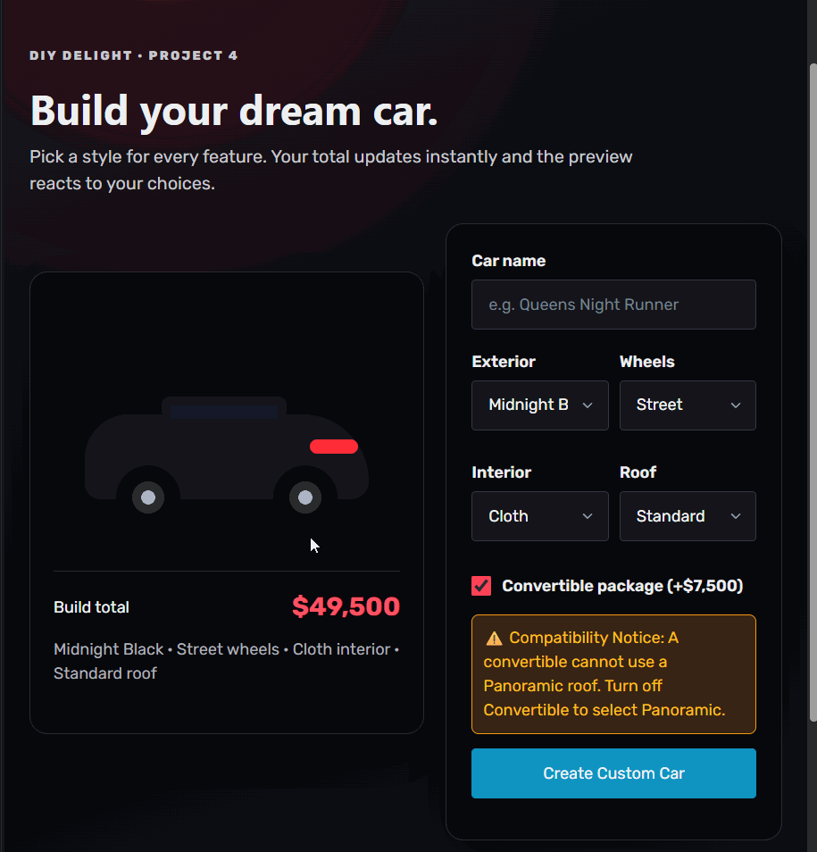

# 🚗 WEB103 Unit 4 Project 4 - DIY Delight: Bolt Bucket

Submitted by: Kevon Dawkins

**Bolt Bucket** is a full-stack car customization application that allows users to design their dream car, preview customization changes, calculate the total price, and save custom builds using a Render PostgreSQL database.

## Required Features

The following **required** functionality is completed:

- [x] The web app uses React to display data from an API
- [x] Data is supplied to the app using a Render PostgreSQL database
  - [x] The web app uses a Render PostgreSQL database
  - [x] The PostgreSQL database includes a table that matches the data displayed in the web app
- [x] The web app has a well-structured user interface
  - [x] The app provides multiple customizable features
  - [x] Each customizable feature has multiple options
  - [x] The total price changes dynamically as options are selected
  - [x] The visual interface changes in response to customization choices
- [x] The web app allows the user to save new custom items
  - [x] Users can submit their choices to save a custom car
  - [x] Users can view all submitted custom cars
  - [x] Impossible feature combinations produce an appropriate error message
- [x] Saved custom items can be updated and deleted
  - [x] Users can edit saved custom cars
  - [x] Users can delete saved custom cars

## Stretch Features

The following **stretch** functionality is completed:

- [x] Users are alerted to impossible combinations before submission
  - Selecting Convertible disables the Panoramic roof option.
  - Selecting Panoramic disables the Convertible option.
  - A compatibility notice explains why the options cannot be combined.

## Additional Features

- Interactive car preview
- Four exterior colors
- Three wheel styles
- Three interior materials
- Three roof options
- Convertible package
- Dynamic price calculation
- Saved-car garage
- Individual car details page
- Persistent PostgreSQL storage
- Separate frontend and backend package configurations
- Responsive dark-themed interface

## Video Walkthrough



## Technology Stack

| Technology | Purpose |
|---|---|
| React | Frontend |
| Vite | Development and build tooling |
| Express | Backend API |
| Node.js | Server runtime |
| PostgreSQL | Persistent database |
| Render | PostgreSQL hosting |
| CSS | Visual car customization |
| React Router | Page navigation |

## Project Structure

```text
web103_unit4_project/
├── client/
│   ├── src/
│   │   ├── components/
│   │   ├── pages/
│   │   ├── services/
│   │   └── utilities/
│   ├── package.json
│   └── vite.config.js
├── server/
│   ├── config/
│   ├── controllers/
│   ├── routes/
│   ├── .env.example
│   ├── package.json
│   └── server.js
├── package.json
├── demo.gif
└── README.md
```

## Installation and Setup

### 1. Clone the repository

```bash
git clone https://github.com/KDawTech/web103_unit4_project.git
cd web103_unit4_project
```

### 2. Install dependencies

```bash
npm run install:all
```

### 3. Configure the database

Create `server/.env` using `server/.env.example`.

```env
DATABASE_URL=YOUR_RENDER_POSTGRESQL_URL
PORT=3000
NODE_ENV=development
```

Never commit actual database credentials.

### 4. Initialize the database

```bash
npm run reset
```

This creates the `bolt_bucket` schema and `cars` table without deleting existing data.

### 5. Start the application

```bash
npm run dev
```

Frontend: http://localhost:5173

Backend: http://localhost:3000

### Production Build

```bash
npm run build
```

## API Endpoints

| Method | Endpoint | Description |
|---|---|---|
| GET | /api/cars | Retrieve all saved cars |
| GET | /api/cars/:id | Retrieve one car |
| POST | /api/cars | Create a custom car |
| PATCH | /api/cars/:id | Update a saved car |
| DELETE | /api/cars/:id | Delete a saved car |

## Database

The PostgreSQL database contains a `bolt_bucket.cars` table with:

- id
- name
- exterior
- wheels
- interior
- roof
- convertible
- price
- created_at

## Testing

- [x] Create a custom car
- [x] View saved cars
- [x] Edit a saved car
- [x] Delete a saved car
- [x] Dynamic price updates
- [x] Visual customization changes
- [x] Early compatibility warnings
- [x] Render PostgreSQL connection
- [x] Frontend production build

## Notes

The original submission was missing the application source files. This updated version restores the complete React frontend and Express backend, improves dependency organization, reconnects Render PostgreSQL, and adds early compatibility validation.

## License

Created for CodePath WEB103 - Advanced Web Development.

Developed by Kevon Dawkins.