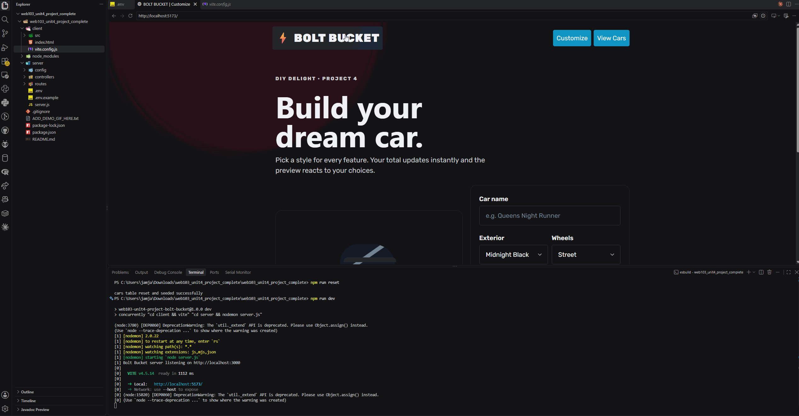

# WEB103 Unit 4 Project 4 - DIY Delight: Bolt Bucket

Submitted by: KDawTech

Bolt Bucket is a full-stack custom-car personalizer built with React, Express, and PostgreSQL. Users can configure multiple car features, see the price and visual preview update immediately, save builds, and edit or delete saved cars.

## Required Features

- [x] The web app uses React to display data from an API
- [x] Data is supplied using a PostgreSQL database
- [x] The database includes a `cars` table matching the data displayed in the app
- [x] Multiple customizable features: exterior, wheels, interior, roof, convertible
- [x] Each feature has multiple options
- [x] Total price changes dynamically
- [x] Visual preview changes for exterior, wheels, roof, and convertible
- [x] Users can save a custom car
- [x] Users can view all saved custom cars
- [x] Impossible combination shows an error (Convertible + Panoramic roof)
- [x] Saved cars can be edited
- [x] Saved cars can be deleted

## Video Walkthrough

Add your walkthrough GIF as `demo.gif` before submitting:

## Setup

1. Run `npm install`
2. Copy `server/.env.example` to `server/.env`
3. Fill in your Render PostgreSQL values in `server/.env`
4. Run `npm run reset`
5. Run `npm run dev`
6. Open the Vite URL shown in the terminal, usually `http://localhost:5173`

## API Routes

- `GET /api/cars`
- `GET /api/cars/:id`
- `POST /api/cars`
- `PATCH /api/cars/:id`
- `DELETE /api/cars/:id`
